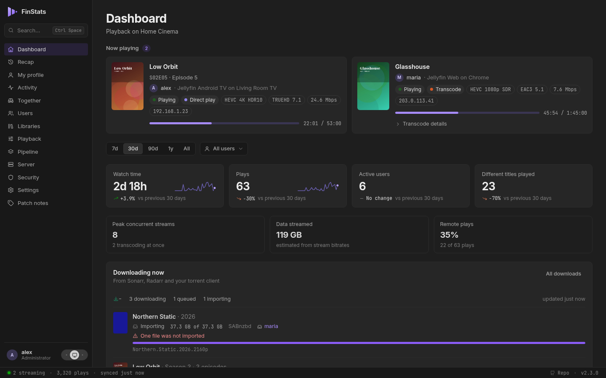

---
hide:
  - navigation
  - toc
---

# FinStats

See what your Jellyfin server is really doing: who is watching, what they watch, how it streams,
and your year in review. One small container, no database server, set up in two minutes.

[Get started](finstats/install.md){ .md-button .md-button--primary }
[Try the demo](https://demo.finstats.no/){ .md-button }

{ .fs-shot }

## What is FinStats?

FinStats is a playback-statistics server for **Jellyfin**: one small program with the web interface built in, beside
your server. It watches what is playing, keeps the history, and turns it into answers: who watches what, which client
transcodes everything it touches, how full the disks are getting, who watched together, and each person's year. It
only ever reads from Jellyfin.

## Private by default

**Sign in with your Jellyfin account.** No new passwords, and family and friends see their own statistics until you
grant them more. **No telemetry**, and no fonts or scripts loaded from the internet: the one outside request FinStats
makes by default is a single "what is my IP" lookup, and one switch turns it off. **Settings → System → Outbound
connections** lists every destination FinStats can reach, so it is a promise you can check. More on the
[Privacy](finstats/privacy.md) page.

## Where to next

-   :material-download: **Get started**

    ---

    One `docker run`, a Jellyfin address, and the first plays arrive within a second.

    [:octicons-arrow-right-24: Install FinStats](finstats/install.md)

-   :material-chart-box-outline: **What you get**

    ---

    Live streams, history, transcodes, libraries, watching together, Pipeline, Security and the Recap.

    [:octicons-arrow-right-24: The features](finstats/features.md)

-   :material-history: **Bring your history**

    ---

    Import what Jellystat, Streamystats or Tautulli recorded, and FinStats carries on from there.

    [:octicons-arrow-right-24: Importing](finstats/imports/index.md)

-   :material-api: **HTTP API**

    ---

    Every endpoint the interface uses, open to your scripts with an API key.

    [:octicons-arrow-right-24: API reference](finstats/api.md)

-   { .fs-tile } **FinUI**

    ---

    The components FinStats is built from: vanilla ES modules and plain CSS, light and dark from one set of tokens.

    [:octicons-arrow-right-24: About FinUI](finui/index.md)

-   { .fs-tile } **FinMotion**

    ---

    How FinUI moves, put on top of it: one stylesheet and one call, four springs.

    [:octicons-arrow-right-24: About FinMotion](finmotion/index.md)

## Elsewhere

- [The FinStats demo](https://demo.finstats.no/): FinStats in your browser, with invented people and titles.
- [The FinUI gallery and FinUI create](https://finui.finstats.no/), and [the FinMotion site](https://finmotion.finstats.no/).
- The code: [FinStats](https://github.com/finstats/finstats), [FinUI](https://github.com/finstats/finui),
  [FinMotion](https://github.com/finstats/finmotion). Patch notes are on
  [FinStats' releases page](https://github.com/finstats/finstats/releases) and in the app's Patch notes tab.
- Questions go to [Discussions](https://github.com/finstats/finstats/discussions); a page here that lost you is a bug,
  [report it on this repository](https://github.com/finstats/docs/issues).
